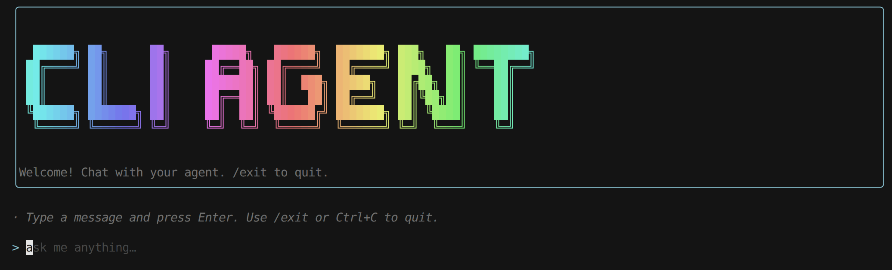
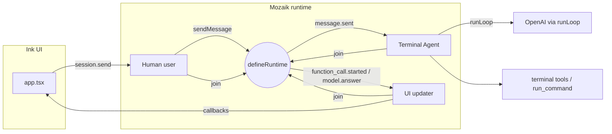

# CLI Agent Starter

A **starter template** for building **terminal CLI agents**: an [Ink](https://github.com/vadimdemedes/ink) chat UI wired to [**`@mozaik-ai/core`**](https://www.npmjs.com/package/@mozaik-ai/core), a TypeScript runtime for **collaborative, event-driven agents**. Humans, agents, and observers join one **runtime**; semantic events fan out to situation handlers so you can compose reactive behaviors without a central scheduler.

Fork or copy this repo, rename the package, add tools and participants, and ship your own agent-backed CLI.



---

## Use this template

This repository is meant to be **copied into a new project** so you keep a **clean git history**.

```bash
npx degit jigjoy-ai/cli-agent-starter my-cli-agent
cd my-cli-agent
git init
git add .
git commit -m "Initial commit"
npm install
```

Replace `jigjoy-ai/cli-agent-starter` with your fork or the published template URL if it moves. Replace `my-cli-agent` with your project folder name.

Then customize:

- Set **`name`** (and optionally **`bin`**) in [`package.json`](package.json).
- Adjust branding and copy in [`source/cli.tsx`](source/cli.tsx), [`source/app.tsx`](source/app.tsx), and this README.

### Alternative: GitHub “Use this template”

If you enable **Template repository** in the repo settings on GitHub, **Use this template** creates a new repository whose **first commit** is the template snapshot—also a straightforward way to start without inheriting long unrelated history.

---

## What this template includes

Built against **`@mozaik-ai/core` ^4.0.5** (see [`package.json`](package.json)).

| Concept | Where it lives |
| --- | --- |
| **`defineRuntime`** — shared runtime, events, and `runLoop` | [`source/runtime.ts`](source/runtime.ts) |
| **`createAgent`** — instruction, tools, situation handlers | [`source/terminal/agent.ts`](source/terminal/agent.ts) |
| **`createHuman`** observer — `model.answer` / `function_call.started` → UI | [`source/ui-updater.ts`](source/ui-updater.ts) |
| **`runLoop`** — context update, inference, and tool execution | [`source/terminal/agent.ts`](source/terminal/agent.ts): `message.sent` handler |
| Declarative **`Tool`** definitions | [`source/terminal/tools.ts`](source/terminal/tools.ts) |

The Ink UI does **not** call OpenAI directly. It calls `session.send(message)`, which publishes a `message.sent` event; the **UI updater** listens for assistant text and tool notifications and updates the UI through callbacks.

---

## Architecture



**Flow in plain language**

1. **`createAgentSession`** calls **`initializeRuntime`**, then **`join`**s a human user, the terminal agent, and a UI observer. User messages go through **`sendMessage(message, user.getId())`**.
2. The terminal agent is a **`createAgent`** participant. On **`message.sent`** from someone else it calls **`runLoop`** with the agent’s memory context and tools. Tool execution and the follow-up inference live inside the loop.
3. The UI updater is a **`createHuman`** observer. It handles **`model.answer`** to surface assistant text to Ink, and **`function_call.started`** to show which tool was invoked.

---

## Prerequisites

- **Node.js** ≥ 18 (see [`package.json`](package.json) `engines`)
- **`@mozaik-ai/core` ^4.0.5** — upgrade or pin in [`package.json`](package.json) if you track a different minor
- **OpenAI API key** — `runLoop` picks a provider from the model name; this starter uses **`gpt-5.4`**

---

## Setup

1. Install dependencies:

   ```bash
   npm install
   ```

2. Configure credentials. Create a **`.env`** in the project directory (or a parent directory — the CLI searches upward from `cwd` and from the install location):

   ```env
   OPENAI_API_KEY=sk-...
   ```

3. Build TypeScript:

   ```bash
   npm run build
   ```

---

## Usage

Run the compiled CLI:

```bash
node dist/cli.js
```

Or link globally after a build (command matches the `"name"` field in `package.json`):

```bash
npm link
cli-agent
```

In the TUI: type a message and press **Enter**. Use **`/exit`**, **`/quit`**, **Escape**, or **Ctrl+C** to quit (Escape exits via Ink’s `useInput`).

When the model calls **`run_command`**, output is also printed to **`stdout`** from the tool implementation (see [`source/terminal/tools.ts`](source/terminal/tools.ts)), which is useful for debugging alongside the chat transcript.

---

## Project layout

| Path | Role |
| --- | --- |
| [`source/cli.tsx`](source/cli.tsx) | Entry: `dotenv`, `meow` help, `render(<App />)` |
| [`source/app.tsx`](source/app.tsx) | Ink UI, local chat state, `createAgentSession` hooks |
| [`source/runtime.ts`](source/runtime.ts) | `defineRuntime`, `RuntimeState`, `join` / `sendMessage` / `runLoop` |
| [`source/session.ts`](source/session.ts) | Wiring: initialize runtime, join user, agent, observer |
| [`source/ui-updater.ts`](source/ui-updater.ts) | Observer situation handlers → UI callbacks |
| [`source/terminal/agent.ts`](source/terminal/agent.ts) | `createAgent` + `message.sent` → `runLoop` |
| [`source/terminal/tools.ts`](source/terminal/tools.ts) | `Tool[]` for `run_command` |
| [`source/terminal/terminal.ts`](source/terminal/terminal.ts) | `spawn`-based command runner |
| [`source/terminal/command-result.ts`](source/terminal/command-result.ts) | Structured command result type |

---

## Development

| Script | Command |
| --- | --- |
| Build | `npm run build` |
| Watch mode | `npm run dev` |
| Lint / format check / tests | `npm test` |

---

## Learning more

- **Package:** [`@mozaik-ai/core` on npm](https://www.npmjs.com/package/@mozaik-ai/core) — this repo pins **`^4.0.5`**; install or upgrade with `npm install @mozaik-ai/core@^4.0.5`.
- **Examples:** [mozaik-examples](https://github.com/jigjoy-ai/mozaik-examples) — `terminal-agent`, situation handlers, `runLoop`, interception, and more.
- The upstream README documents **`defineRuntime`**, **`createAgent`** / **`createHuman`**, **situation handlers**, and **`runLoop`**. This starter focuses on **one human + one agent + one observer** as a minimal base.

To extend your CLI: add another **`createAgent`** or **`createHuman`**, **`join`** it to the same runtime, and register situation handlers for the events you care about (`message.sent`, `model.answer`, `function_call.started`, …).

---

## License

MIT — see [`package.json`](package.json).
