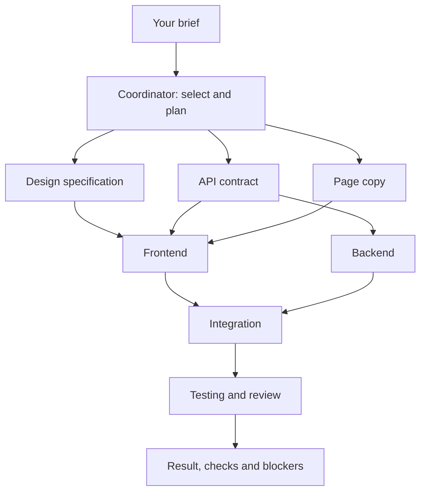

# JigJoy

### One brief. The right team. Work in motion.

**JigJoy turns a request into a working AI team: it selects specialists, starts independent work in parallel, passes results between agents, and shows the whole process live.**

50 specialist roles. One coordinator. Only the agents the task needs.

## The pitch

Building a feature crosses disciplines: design, frontend, backend, testing, sometimes launch copy. JigJoy gives that work an explicit plan, clear ownership, and visible handoffs.

Ask for the outcome. Watch the team assemble. Follow the work from brief to verified result.

## What you can see in the demo

- **A team assembled on demand.** The coordinator chooses from 50 roles; unused specialists never join the session.
- **Real parallel work.** Independent agents can make model requests and run tools concurrently. The dashboard shows how many specialists have active tasks.
- **Useful handoffs.** Frontend receives the designer's actual specification. Integration receives implementation results. Verification waits for the work it checks.
- **Visible accountability.** Each agent has its own task, acceptance criteria, activity, changed files, checks, and blockers.
- **Failures that stay local.** A blocked prerequisite stops its dependents. One agent's failure does not clear another agent's live status.

## Try it

**Prerequisites:** Node.js 18.19+ (Node 22 recommended), npm, and an OpenAI API key with access to the configured `gpt-5.4` model. API calls use your provider account.

```bash
git clone https://github.com/Kristina480/jigjoy-project.git
cd jigjoy-project
npm ci
npm --prefix web ci
```

Create `.env` in the project root:

```env
OPENAI_API_KEY=your_api_key_here
```

Then launch both services:

```bash
npm run dev:all
```

Open **http://localhost:5173**. The backend runs on **http://localhost:3001** and exposes `/health` and `/ws`.

> Applying the downloaded upgrade? Copy its files into your existing checkout first. The ZIP contains changed files, not a complete repository. Instructions: [docs/PRIMENA_IZMENA.txt](docs/PRIMENA_IZMENA.txt).

### Give the team a real brief

```text
Build a product landing page and a newsletter signup endpoint.
Use separate frontend and backend file scopes and agree on the API contract first.
Have a designer define the visual direction while a copywriter drafts the page copy.
Run independent work concurrently. Integrate the result, then test it.
Do not publish, deploy, commit, or open a PR.
```

Use a fresh server session for a clean demo roster. Tell JigJoy the target project path and relevant constraints when the code to change is outside the current working directory.

## How the team works



Design, contract work, and copy can start together. Once the contract is ready, backend can proceed while frontend waits for the inputs it actually needs. Integration and verification start after their prerequisites succeed.

The coordinator submits a complete task graph through `delegate_team_plan`. Each task specifies:

| Field                | Purpose                                             |
| -------------------- | --------------------------------------------------- |
| `key`                | A unique task identifier inside the plan            |
| `role`               | The specialist responsible for the work             |
| `task`               | Concrete work and file or responsibility boundaries |
| `acceptanceCriteria` | What successful completion means                    |
| `dependsOn`          | Tasks whose successful results are required first   |

The router launches all ready tasks within capacity, reuses free agents, and supplies completed prerequisite results to the next workers. It rejects unknown roles, invalid dependencies, and duplicate task keys; unresolved cycles return blocked results.

### Parallel execution, all the way down

JigJoy's application loop executes **every tool call** in a model response and returns an output for every call ID. Tool batches overlap; different agent IDs have independent execution queues. Turns for the same agent remain ordered to protect its conversation context.

Backend assistance has an isolated coordinator handoff so a worker can request help while the main coordinator is waiting. Result submission runs after the other tools in its batch. An accepted result finishes the worker turn; errors or missing submissions return a blocker instead of waiting for the full task timeout.

Real dependencies remain sequential. A design inspection can overlap a designer's proposal; implementing that proposal still waits for it.

## 50 roles, selected for the job

| Area                        | Examples                                                                               |
| --------------------------- | -------------------------------------------------------------------------------------- |
| Product and planning        | Product Manager, Business Analyst, Project Planner, Software Architect                 |
| Design and experience       | Designer, UX Researcher, Accessibility, Design System, Brand Designer                  |
| Engineering                 | Frontend, Backend, Fullstack, Mobile, Desktop, API Integration                         |
| Quality and reliability     | Tester, Quality, Test Automation, Debugger, Refactoring, Performance                   |
| Infrastructure and security | DevOps, Cloud, Infrastructure, CI/CD, Observability, Authentication, Security          |
| Data and AI                 | Data Analyst, Data Engineer, Data Scientist, ML Engineer, AI Engineer, Prompt Engineer |
| Content and growth          | Marketing, Copywriter, Social Media, Email Marketing, SEO, Content Strategist, Growth  |

See [all 50 roles and their responsibilities](docs/AGENT_CATALOG_50.md). These are curated specializations of the same agent system, with distinct instructions and tools. They are not 50 separate models or a measured popularity ranking.

### Files, processes and complete requirements

The factory includes native `get_workspace_info`, `list_files`, `read_file` and
`write_file` tools. Source files are written through Node's filesystem APIs instead
of Bash heredocs, so quoting, Unicode and paths with spaces do not depend on the shell.
Finite commands have a timeout; long-running package server commands are redirected
to `start_process`. Agents can inspect output, verify local endpoints with
`http_request`, and clean up with `stop_process`.

The coordinator loads a user-designated specification using `load_project_requirements`.
Every worker receives the full original brief and follow-ups, plus prerequisite results;
a short delegated task title no longer has to carry every requirement. Each running
plan keeps its own brief snapshot. Rejected result submissions can be corrected;
reported blockers cannot be hidden behind a contradictory done status.

An optional `JIGJOY_WORKSPACE` environment variable selects the workspace root.
Otherwise the factory uses the working directory. Source paths are resolved under
that root and the actual OS/shell is reported before work begins. Technical tools
still run with the host's access; this is not a security sandbox.

### Prepared next exercise: Box Office

The input is ready in [examples/box-office/specification.md](examples/box-office/specification.md).
The [exercise instructions](examples/box-office/README.md) include a plan-only prompt
and a later implementation prompt. This upgrade prepares JigJoy for that workflow;
it does not claim a real-model Box Office generation has been completed.

An integration fixture loads that complete input, dispatches a real role-agent handler,
and writes a requirements receipt through the actual file tool. File/process tests
start a real local server, inspect its output, call it over HTTP and stop it. Inference
is deterministic in these tests. Native tools were exercised on Linux, including
Unicode/space-containing paths; the Windows process-tree shutdown branch is not live-tested here.

Twelve team recipes guide common tasks. The coordinator adapts them to scope instead of launching a fixed team for every request.

## The control room

The browser dashboard includes:

- Chat with the coordinator.
- Agent cards with live status and a count of working specialists.
- Per-agent tasks, acceptance criteria, activity, results, and blockers.
- A communication log showing assignments, handoffs, and replies.
- Event replay when a browser reconnects or reloads.

The Ink terminal UI remains available:

```bash
npm run build
node dist/cli.js
```

## Built with

**TypeScript · Mozaik AI Core · OpenAI · React · Vite · WebSocket · Ink · AVA**

Mozaik supplies the participant, inference, tool, and event primitives. JigJoy adds the role catalog, task graph scheduler, concurrent application loop, coordination policy, and live dashboard.

| Path                            | Responsibility                                                    |
| ------------------------------- | ----------------------------------------------------------------- |
| `source/session.ts`             | Session wiring and lazy specialist creation                       |
| `source/concurrent-loop.ts`     | Complete tool batches, concurrent agents, ordered per-agent turns |
| `source/terminal/agent.ts`      | Coordinator policy and validated incoming requests                |
| `source/agents/role-catalog.ts` | 50 specialist definitions and tool access                         |
| `source/agents/team-recipes.ts` | Example teams and dependency patterns                             |
| `source/agents/task-router.ts`  | Capacity, dispatch, task graphs, handoffs, results and timeouts   |
| `source/agents/role-agent.ts`   | Targeted specialist task execution                                |
| `source/terminal/`              | Terminal command execution                                        |
| `server/`                       | WebSocket backend, event translation and browser history          |
| `shared/`                       | Browser events and role display metadata                          |
| `web/src/`                      | React dashboard and event reducer                                 |
| `docs/`                         | Role inventory, architecture details and upgrade instructions     |

## Verify the build

After installing both sets of dependencies:

```bash
npm run check
```

This builds the CLI, type-checks the server, runs agent and dashboard tests, and builds the web app. You can run each check separately:

```bash
npm run build
npm run typecheck
npm run test:agents
npm --prefix web run build
```

The concurrency regression test uses **real coordinator and specialist handlers with a deterministic inference runner**. It holds frontend, backend, and marketing active at the same time, checks that the dashboard reports three workers, completes one while the other two remain active, and allows testing only after all prerequisites finish.

Tests make no external model calls. They verify execution and state transitions; live model selection and provider behavior still need an API-backed demo run.

`npm test` also runs the repository-wide formatting and XO lint gates. The inherited checkout has separate formatting and lint compatibility issues; `npm run check` does not claim those gates pass.

## Demo playbook

1. **Start clean.** Restart the backend and open the dashboard. Have a disposable target project ready.
2. **Give an outcome.** Use the landing-page brief above, including the target path.
3. **Point to the team.** Explain why those roles were selected and why unrelated roles stayed out.
4. **Show overlap.** Independent workstreams should appear together in the working-specialist count. Exact timing depends on the model's plan and response times.
5. **Follow a handoff.** Open frontend's task and show the design or contract results it received.
6. **Close with evidence.** Show checks, changed files, and any honest blockers. Review the generated work before using it.

**Closing line:** “JigJoy turns a brief into a team you can watch, inspect, and direct.”

## Current boundaries

- **One shared session per server.** Connected browsers see the same team and history. Restart the server to reset it; history is in memory.
- **Bounded team size.** The default is 8 instantiated specialists per session and 2 instances per role. `createAgentSession` accepts `maxAgents` from 1 to 32 and frontend/backend role limits. Free agents are reused first. When a different role needs a full slot, the session retires an idle specialist; busy agents are never retired. Historical identity remains available for communication logs.
- **Scoped tools.** Technical roles use the local terminal with the host process's access. Text-only roles work with provided information. A role name does not create a connected service or a security sandbox.
- **Model-led planning.** The model chooses roles and dependencies; the router enforces execution of the submitted graph. There is no promise of identical plans or automatic speedup on every brief.
- **Explicit publishing.** The coordinator requests GitHub finalization only when the user asks for it. PR creation requires Git and authenticated `gh`; merging is outside the finalizer's role.

## Credits and license

Built on the CLI Agent Starter and [Mozaik AI Core](https://www.npmjs.com/package/@mozaik-ai/core). MIT, as declared in [package.json](package.json).
